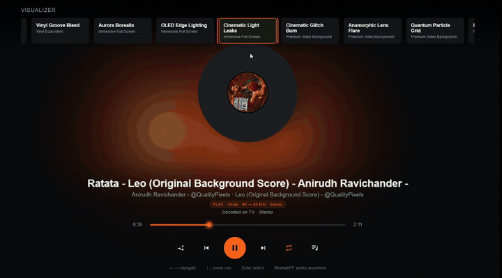

# m-box TV — Tizen prototype

Samsung Smart TV (Tizen web app) for **M-Box**, a hi-res music player for Android.
Pick the TV in the phone's **Play on** sheet and the song continues on the TV from the same
second — like Spotify Connect, for your own FLAC, hi-res and Dolby music.



▶️ **[Watch the full demo (75 s)](docs/media/mbox-tv-visualizers.mp4)**

## Features
- Opened by the phone with one tap (even when closed); finds the phone automatically
  (launch data → last phone → Wi-Fi scan).
- **AVPlay** for FLAC/ALAC and Dolby Digital Plus / Atmos (passed to the soundbar over HDMI eARC),
  **HTML5 audio** for MP3/AAC/Ogg.
- Pre-flight check of each file; asks the phone for a TV-safe copy above 48 kHz / 24-bit / 2 ch.
- Queue on the TV, "Up next", stream recovery at the same position.
- 17 visualizers + Off + Ambient Cover at 60 fps, album art from the file, lyrics, TV volume.

## Project layout
```
config.xml            Tizen app manifest (id MBoxTVApp1.MBox, privileges)
index.html            UI
css/style.css         styles (1920x1080)
js/app.js             start-up, screens, remote keys
js/remoteBridge.js    WebSocket link to the phone (commands in, state out)
js/phoneDiscovery.js  finds the phone on the Wi-Fi
js/player.js          playback, queue, album art
js/playerBackend.js   AVPlay / HTML5 audio backends
js/visualizerManager.js + js/visualizers/   the visualizers
js/lyricsView.js, js/ambientView.js, js/tvVolume.js
js/fitScreen.js       PC browser only: scales the 1920x1080 page to the window
videos/               pre-rendered frames for 3 visualizers
tizen_web_project.yaml  Tizen project file (VS Code Tizen extension)
docs/media/           demo GIF and video
```

## Build & install
1. Open this folder in **VS Code with the Tizen extension** (it reads `tizen_web_project.yaml`), or in
   Tizen Studio create a **TV › Web Application › Basic Project** and copy these files into it.
2. Create a **Samsung certificate** (Certificate Manager) with your TV's DUID.
3. TV: **Apps → 1 2 3 4 5** → Developer mode **On**, enter your PC's IP, restart the TV.
4. Device Manager → connect `<TV-IP>:26101`, then **Run As › Tizen Web Application**, or:
   ```
   sdb connect <TV-IP>:26101
   tizen package -t wgt -s <your-profile> -- .
   tizen install -n MBox.wgt -s <TV-IP>:26101
   ```

### Run in a PC browser (demos / recording)
```
python -m http.server 8934
```
Open `http://localhost:8934/index.html` (F11 for full screen). AVPlay-only formats (Dolby,
24-bit FLAC) don't play in a browser.

## Requirements
Tizen 4.0+ Samsung TV (tested on QN85C), the M-Box Android app on the same Wi-Fi.

## License
Apache License 2.0 — see [LICENSE](LICENSE).
